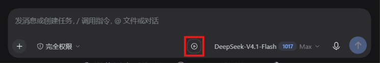

# client-resume-button

[](./LICENSE)
[](https://github.com/deepseek-ai/deepseek-harness)

给 DeepSeek Harness 的输入框加一个「继续」按钮：上一轮被中断后，点一下就能让模型接着把那一轮做完。

[English](./README.en.md) | 中文

---

## 效果



红圈处即「继续」按钮，位于模型选择器左侧。开始输入或添加附件时它收窄消失，清空后展开回来。

## 功能

按钮可见需要同时满足两点：

- 上一轮以 `aborted`（用户按停止）、`interrupted`（崩溃）或 `error` 结束
- 主提交按钮处于禁用态——即输入框为空、没有待上传附件、也没有轮次在跑

`aborted` 只在子原因为用户主动停止时才算，超时或策略取消不算。

点击后发送两条 plugin 来源的提示给模型：一条要求继续，一条提醒检查残留进程、不重做已完成步骤。

## 安装

```
插件页 → 「添加插件」→ 输入 client-resume-button → 安装 → 重启 DSH
```

命令行等价写法（`--profile` 填你实际在用的：桌面客户端 `desktop`，`dsh web` 用 `web`）：

```sh
dsh plugin --profile desktop add client-resume-button
```

**装完必须重启 DSH**，浏览器端代码只在启动时加载。

<details>
<summary>其他安装方式</summary>

从 Git 仓库（需要能访问 `github.com`）：

```sh
dsh plugin --profile desktop add github:ddy-007/dsh-client-resume-button
```

若 `github.com` 不可达，可临时借助 `ghproxy.net` 这类第三方镜像转发。镜像只是绕开网络限制的便利手段，不是推荐路径——它会把安装流量经第三方转发，其供应链可信度未经本项目评估。优先用 npm 包或直连 GitHub。

```sh
dsh plugin --profile desktop add https://ghproxy.net/https://github.com/ddy-007/dsh-client-resume-button.git
```

改源码时用 `link:`，不必每次重装，改完只需重启：

```sh
dsh plugin --profile desktop add "link:<仓库绝对路径>"
```

</details>

## 卸载

```sh
dsh plugin --profile desktop remove client-resume-button
```

## 验证

```sh
npm test      # 26 个断言：三种中断各留标记，completed 与超时不留
npm run record   # 每态一次折叠的人可读记录
npm run verify   # 在临时 DSH_HOME 里用真实投影注册表跑一遍
```

`npm test` 与 `npm run record` 只碰 `lib/projection.js`，它没有 import，所以不需要装依赖、不需要联网。`npm run verify` 需要 SDK 依赖（`pnpm install`），它会挂载真实的 Cordis 上下文与投影注册表，向真实 `Session` 追加真实事件，再读客户端渲染用的那份快照。

用例的事件形状取自真实会话日志，不是构造的近似值。

## 限制

- **按钮位于模型选择器左侧**，不在主提交按钮旁。更近的 `conversation.input.activity` 槽位是 `single` 类型，已被语音输入插件占用，抢占会导致应用无法启动。
- **开始新一轮后按钮就消失**。中断标记会在下一次 `turn/start` 时清除——中断后只要又发了消息，无论内容是什么，都无法再「继续上一轮」。
- **不能恢复中断时的半截输出**。那部分内容从未写入日志，插件是新开一轮 turn 重做，而非续写原流。

## 兼容性

实测 DSH `0.2.0-rc.2`、`0.2.1-rc.2`。`dsh.engines.dsh` 声明 `>=0.2.0-rc.2 <0.2.1-0 || >=0.2.1-rc.1 <0.3.0-0`，低于下界或达到 `0.3.0`（含 `0.3.0-rc.1` 这类预发布版）会被拒绝安装。

范围写成两段而不是 `>=0.2.0-rc.2 <0.3.0`，是因为后者会静默排除所有 `0.2.1-*` 预发布版：node-semver 只有在**某个比较符自身**与目标版本共享完整的 `major.minor.patch` 元组、且该比较符带预发布标签时才放行预发布版本。写成一整段时，`0.2.1-rc.2` 被排除，`npm install` 会直接报 `ERESOLVE`。DSH 自己的兼容门用 `includePrerelease: true` 求值，恰好看不出这个问题——所以两段式是这个缺陷的修复，不是风格偏好。

同样地，`@deepseek-ai/*` 的 peer 范围全部写明版本线，没有一处用 `"*"`。这些包在 npm 上的 `latest` 标签停留在很久以前的版本（配套 harness 的线在 `next` 上），`"*"` 会让 npm 挑 `latest`，展开出一份 `0.0.x` 的旧依赖图，其中包含从未发布到 npm 的包，安装当场失败。

依赖以下内部约定，DSH 升级后可能失效：`turn/end` reason 枚举、`conversation.input.right` 槽位、`<hash>_primary` 类名、`agent.inbox.prepend` / `agent.steer`、`window.__ModuleLoader__.load`。

## 许可

MIT
